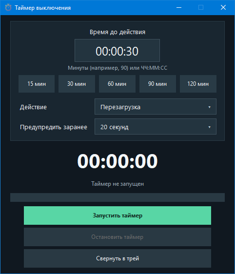

# Таймер выключения

Приложение для Windows на Python и Tkinter. Таймер умеет выключать компьютер, перезагружать его или переводить в сон.

## Возможности

- Время задаётся числом минут или в формате `ЧЧ:ММ:СС`.
- Быстрые пресеты: 15, 30, 60, 90 и 120 минут.
- Можно выбрать действие и задержку предупреждения (0, 20 или 60 секунд).
- Выключение, перезагрузку и сон можно отменить кнопкой в приложении до начала действия. Предупреждение перед действием не блокирует окно и содержит отдельную кнопку отмены.
- Крестик закрывает приложение. Для сворачивания в системный трей используйте кнопку в окне; через меню значка можно вернуть окно или завершить программу.
- Последнее время и выбранные параметры сохраняются в `%APPDATA%\Таймер выключения\settings.json`.
- Отсчёт строится от монотонных часов и не накапливает задержку интерфейса.

## Запуск из исходников

```powershell
python -m pip install -r requirements.txt
python main_app.py
```

## Сборка EXE

```powershell
python lol.py
```

Готовый файл появится в папке `output`.
